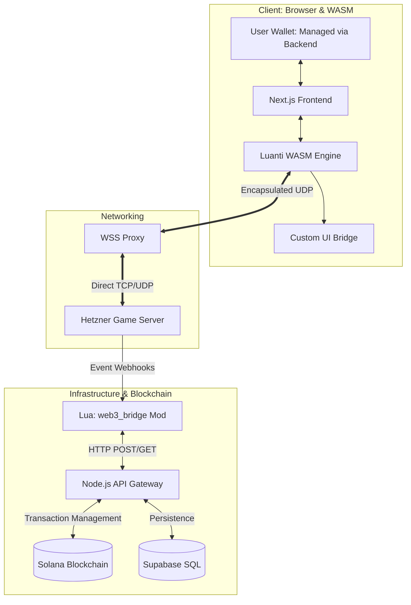

<p align="center">
  <a href="https://oredig.com">
    
  </a>
</p>

<br><br>

**Official site: [oredig.com](https://oredig.com)**

# OREDIG: Ore Mining Voxel Game on Solana

OREDIG is a browser-based, high-stakes voxel metaverse and ore-mining game built natively for the Solana blockchain. Every block you mine can map to an on-chain asset; survival, building, and competition have real economic weight.

Originally developed for the 2026 Colosseum Frontier Hackathon. All Solana wallet, transaction, and protocol integrations are preserved; only branding has been converted to **OREDIG / oredig.com**.

---

## 1. System Architecture & Data Flow

OREDIG uses a specialized "Triple-Bridge" architecture to connect the high-performance C++ game engine (Luanti) with the Solana Web3 stack. The system is designed for low-latency, browser-native gameplay.



---

## 2. Core Gameplay Mechanics

### The World: The Infinite Frontier
Unlike traditional metaverse projects with artificial land scarcity, OREDIG features an **infinite world** generated procedurally. 
- **The Infinite Map:** There are no borders or invisible walls. Players are free to explore, colonize, and build anywhere in the expanding voxel wilderness.
- **Spawn Sanctuary:** A tiny 10-block radius around the initial spawn point is protected. Beyond this point, the "Sovereign Frontier" begins.

### The Stakes: Hardcore Survival
- **Omnipresent PvP:** Outside the spawn sanctuary, combat is enabled globally. 
- **Permadeath:** Death has real consequences. Upon a player's death, the Lua engine clears the character's inventory, spawns all items as physical entities on the ground for looting, and resets the character’s local state.

---

## 3. Web3 Integration & The Frontier Economy

OREDIG leverages Solana's speed to ensure that every in-game action has an on-chain reflection. All original Solana integrations are intact.

| Category | Feature | Description |
| :--- | :--- | :--- |
| **Tokens** | **SPL Token Assets** | Every block type (Dirt, Wood, Gold, Ore) corresponds to a specific SPL-Token Mint on the Solana Blockchain. |
| **Trade** | **dBlocks** | Decentralized blocks where players store items and set prices. Interacting with a dBlock opens a UI overlay to finalize the swap via the player's wallet. |
| **Finance** | **External Liquidity** | While not physically in the game, the economy is driven by external Liquidity Pools, allowing resource tokens to be traded for USDC or SOL. |
| **Identity** | **NFT Skins** | The backend verifies NFT ownership (e.g., Mad Lads). Lua scripts apply custom textures based on the wallet's contents. |
| **Access** | **NFT Keycards** | Specialized steel doors that only unlock if the player possesses a specific NFT "Keycard" in their managed wallet. |
| **Ad Space** | **Token-Gated Billboards** | Large in-game canvases that render external images. Players pay Solanium Coins to display custom IPFS-linked artwork. |

---

## 4. Project Structure

```text
📁 OREDIG-monorepo
 ┣ 📁 web           # Next.js Frontend: UI, Managed Wallet Interface, and WASM Engine
 ┣ 📁 backend       # Node.js API Gateway: Handles Webhooks, SQL, and Solana Transactions
 ┣ 📁 game-server   # Luanti Engine (Server-side) + oredig_main world
 ┗ 📄 banner.png
```

---

## 5. Research Notes — NetCoin, CoinCraft & Mojang (for Ore Mining Voxel Game)

These repositories inform future ore-mining systems. They are reference material only; none are directly copied.

### Juanan7676/netcoin
Bitcoin-inspired cryptocurrency inside Minecraft's OpenComputers mod (decentralized nodes, shared ledger, SHA-256 PoW, in-game computer mining). ~5-minute block times, 10 KB max block size. Reward halving planned.

**Useful ideas:** virtual mining computers, networked mining rigs, hashing-power dashboards, player-operated node systems.

### taylorking/CoinCraft
Historical CraftBukkit plugin for competitive Minecraft mining linked to Bitcoin payouts. First to mine remaining diamond ore in an arena wins. Original Heroku backend no longer running.

**Useful ideas:** timed mining tournaments, arena boundaries, ready-up lobbies, winner announcements, competitive leaderboards. Adapt as fictional-token gameplay (do not reuse real-money betting).

### Mojang repositories
- Brigadier — structured command parsing
- DataFixerUpper — migration of structured saved data
- ore-ui — UI components (unrelated to Solana ORE)
- Bedrock Samples — Bedrock add-on examples

Useful for engineering patterns without adopting Minecraft branding, proprietary textures, or incompatible engine code.

### Recommended integration architecture

| Feature | Reference | Priority |
| :--- | :--- | :--- |
| Mining computers and node networks | NetCoin | P1 |
| Mining rig upgrades and hash-rate simulation | NetCoin | P1 |
| Competitive ore-hunting arenas | CoinCraft | P1 |
| 60-second mining tournaments | CoinCraft + ORE design | P1 |
| Command system | Mojang Brigadier concepts | P2 |
| Save-format migrations | Mojang DataFixerUpper concepts | P2 |
| Solana wallet and verified receipts | Existing project | P0 |
| Mining rewards and economy safeguards | Existing project | P0 |

### Compatibility and licensing
Neither NetCoin nor CoinCraft displayed a top-level LICENSE in the root listing inspected. Permission to copy implementation code has not been established. Safest path is clean-room implementation inspired by documented gameplay concepts.

The three projects use different technologies (OpenComputers/Lua, older CraftBukkit, Java/Bedrock). None can be inserted as a complete module into this Next.js/Luanti project.

### Proposed next build
Develop two independent gameplay systems that coexist with the existing Solana wallet and read-only protocol integrations:

- **Ore Mining Network:** Players construct mining rigs, connect virtual nodes, upgrade computing capacity, and earn simulated in-game mining rewards.
- **Competitive Arena:** Up to 25 participants enter a timed voxel-mining challenge, compete to discover valuable ore, and receive server-verified game rewards.

---

All Solana integrations remain unchanged. Only branding has been converted to **OREDIG / oredig.com**.
